# HisaabWise for Android

The Android version of HisaabWise, a personal-finance app for the UAE market that pairs expense tracking with financial education. It is a feature-for-feature port of the iOS app (`HisaabWiseIOS`) and uses the same backend (`HisaabWiseBackend`).

- **UI:** Kotlin, Jetpack Compose, Material 3 themed to the HisaabWise palette
- **Architecture:** MVI (State · Intent · Effect per screen); see [ARCHITECTURE.md](ARCHITECTURE.md)
- **Backend:** <https://github.com/makinananya-cyber/HisaabWiseBackend>
- **Languages:** English, Arabic (RTL), Hindi, Filipino, Nepali, Urdu (RTL); copy generated from the iOS string catalogue

## Features

| Area | What's there |
|---|---|
| Onboarding | Splash, Landing with rotating straplines, Sign in ("Keep me signed in"), 3-step registration (details → money and security questions → savings goal), Forgot password (security questions + date of birth) |
| Home | Spending donut with tap-to-isolate, savings meter and goal editing, tip of the day, streak card, articles |
| Expenses | Monthly summary, wants budget with an editable share, 7 categories (log entries, utility bills, rent), re-filing when a month has closed |
| Learn | 5 units / 15 lessons path, lesson player (teach, single choice, multi-select, numeric), hearts, combos, XP, streak, completion screen |
| Reports | Archive by year, savings-goal trend chart, month detail with split bar and every logged entry |
| Account | Personal info, language, currency, password change, guided tour, log out, delete account |
| Platform | Keystore-encrypted session, privacy cover in Recents, per-app language, TalkBack labels, font scaling, reduced-motion support |

## Screenshots

Captured from the debug build on an Android 17 emulator against the local backend.

| | | | |
|---|---|---|---|
| 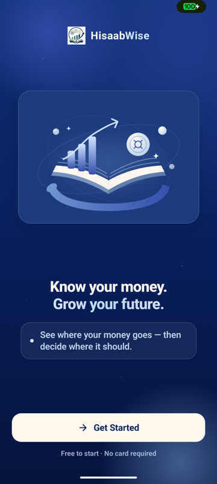 | 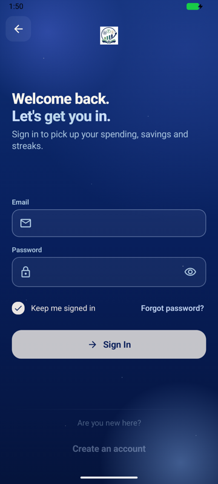 | 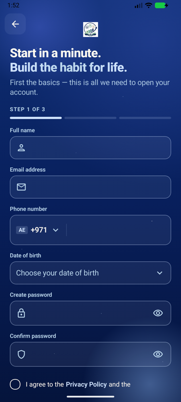 | 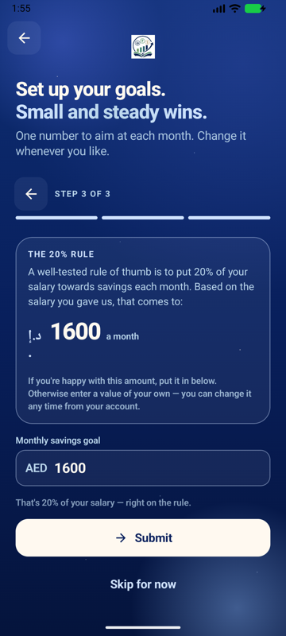 |
| Landing | Sign in | Registration · details | Registration · goal |
| 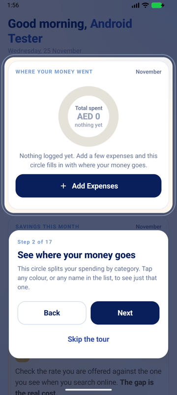 | 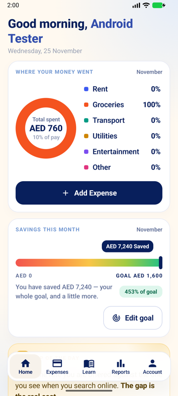 | 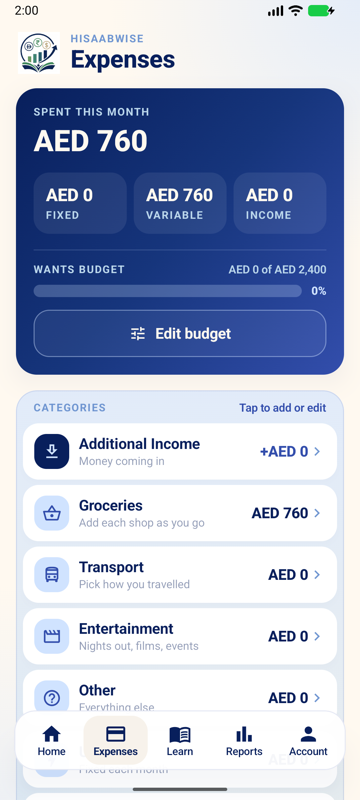 | 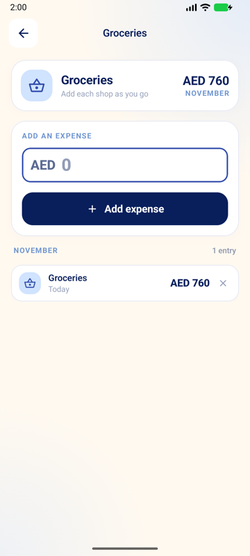 |
| Guided tour | Home | Expenses | Expense category |
| 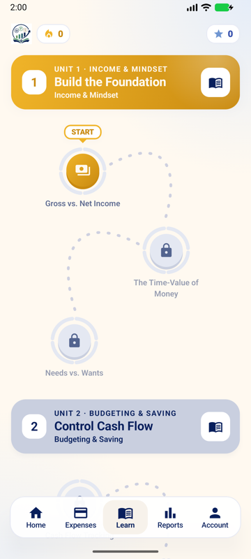 | 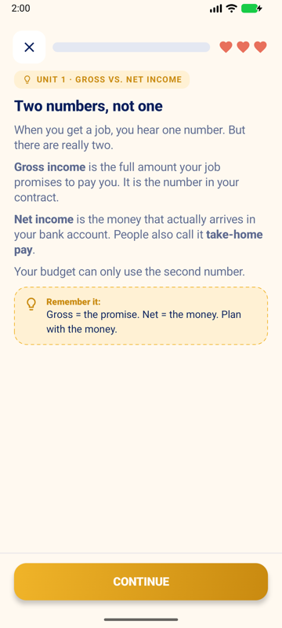 | 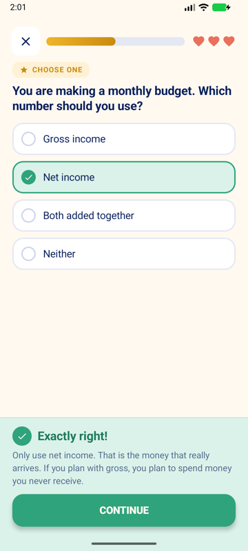 | 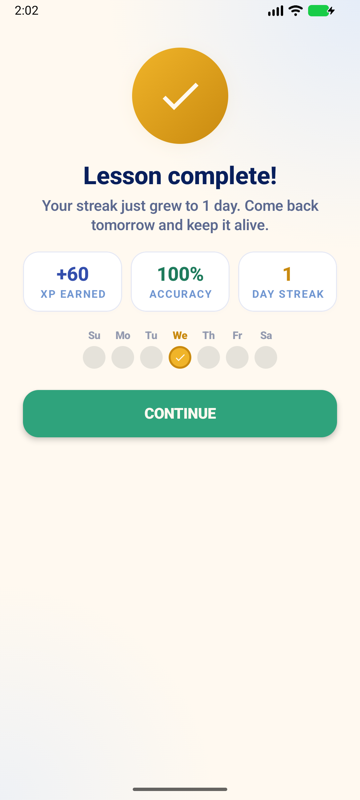 |
| Learn path | Lesson · teaching | Lesson · answer | Lesson complete |
| 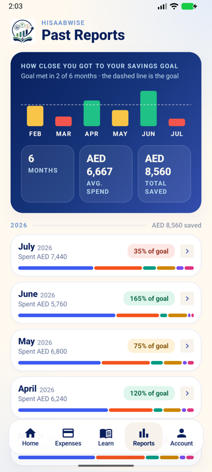 | 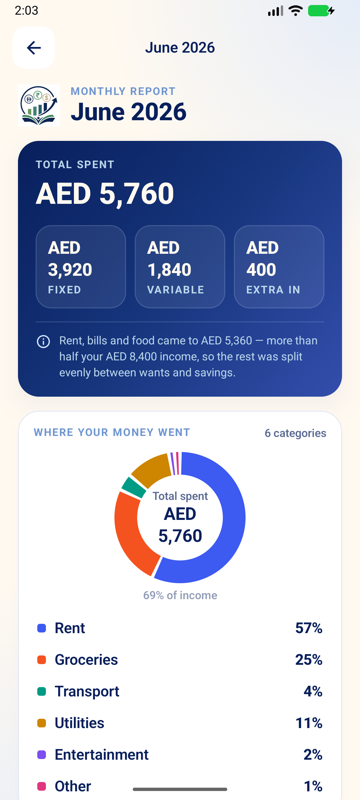 | 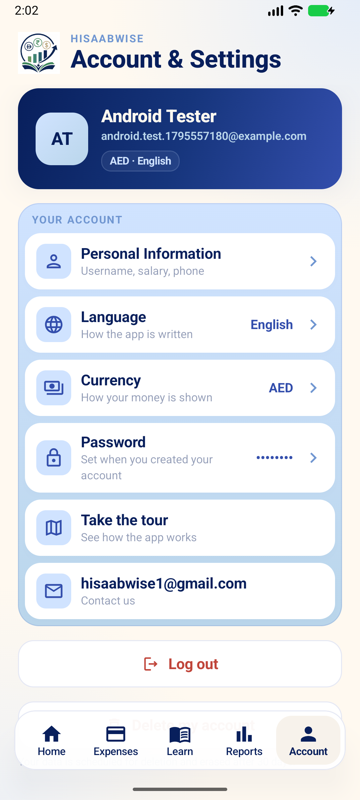 | 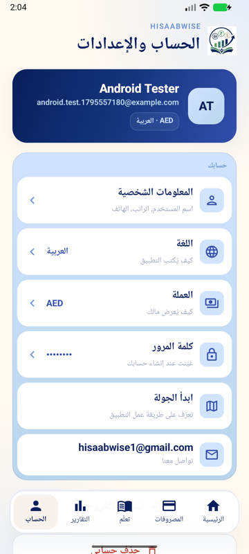 |
| Reports | Month report | Account | Arabic (RTL) |

## Requirements

- Android Studio (2026.2 or newer), or JDK 17+ with the Android SDK (platform 37)
- For the debug build: the backend running locally (`cd ../HisaabWiseBackend && npm run dev`, port 8080), forwarded to the emulator or phone:

```bash
adb reverse tcp:8080 tcp:8080
```

## Build and run

```bash
export JAVA_HOME="/Applications/Android Studio.app/Contents/jbr/Contents/Home"
```

```bash
./gradlew :app:installDebug
```

```bash
./gradlew :app:testDebugUnitTest
```

| Build type | Talks to |
|---|---|
| `debug` | `http://localhost:8080` (your machine, via `adb reverse`) |
| `staging` | `https://hisaabwise-backend-0l9b.onrender.com` |
| `release` | `https://hisaabwise-backend-0l9b.onrender.com` (minified) |

## Updating copy

Strings come from the iOS catalogue. After the iOS `Localizable.xcstrings` changes:

```bash
python3 tools/convert_strings.py ../HisaabWiseIOS/HisaabWise/HisaabWise/Resources/Localizable.xcstrings
```

## Branches

Work happens on `feature/mvp`, then goes to `release` (staging), then `main` (production), matching the other HisaabWise repos.
